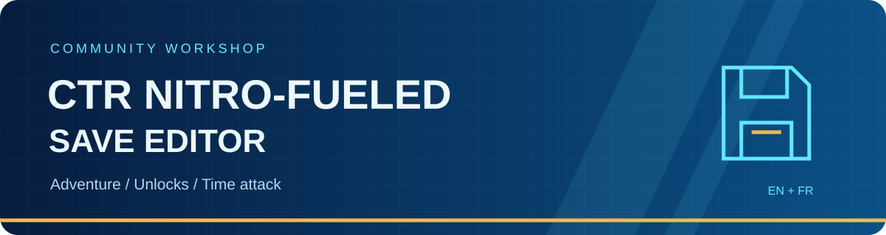

<p align="center"></p>

<p align="center">
  <a href="https://github.com/vzeol/ctrnf-save-editor/actions/workflows/ci.yml"></a>
  <a href="https://github.com/vzeol/ctrnf-save-editor/releases/latest"></a>
  
  <a href="LICENSE.md"></a>
</p>

<p align="center"><strong>English</strong> · <a href="docs/fr/README.md">Français</a></p>

# Your save, your workshop

A community editor for **decrypted CTR Nitro-Fueled PS4 save files**, with a Windows interface in English and French and a command-line companion. Edit Adventure progression, inspect the shared global profile, manage named unlocks and adjust existing time-trial records.

**Help build it.** Missing an item, translation, condition or confirmed game behavior? [Open an issue](https://github.com/vzeol/ctrnf-save-editor/issues/new/choose) or [send a pull request](CONTRIBUTING.md). Controlled before/after observations are particularly valuable. The catalogue and format research need community review.

## Download and start

1. Download the Windows x64 ZIP from [Releases](https://github.com/vzeol/ctrnf-save-editor/releases), then extract the whole archive.
2. Close the game and keep a separate copy of your original saves.
3. Run `ctrnf-save-gui.exe`. Release ZIPs include the .NET runtime; no SDK is required.
4. Choose **Open Adventure save** or **Open global profile**, make your changes and use **Save as** for the first test.

Version 1.0 includes experimental mappings. A successful file edit is not a guarantee that every item has been verified in-game. See the evidence boundaries below and the [usage guide](docs/usage.md). Future fixes and improvements will follow through issues, pull requests and versioned releases.

## About and updates

Open **About** from the toolbar or welcome screen for the version, credits and project links. The optional startup check contacts **api.github.com only**, sending a release GET request with the editor version as User-Agent. Disable it in About; manual checks remain available. Only update preferences (`checkUpdatesAtStartup` and `skippedVersion`) are stored in `%LOCALAPPDATA%\ctrnf-save-editor\settings.json`; no save data is sent.

Extracted, writable release packages can download and verify the ZIP and SHA-256 sidecar from GitHub, then install and restart after you save or discard edits. Downloads can be cancelled. Development builds offer the release page. The previous installation is copied to `%LOCALAPPDATA%\ctrnf-save-editor\previous\<old-version>\`. To roll back, close the editor and copy that folder's contents over the installation folder. Save files are never updated. If copying fails, the previous version is restored and restarted automatically. Installation failures are logged under `%LOCALAPPDATA%\ctrnf-save-editor\updates\<version>\<run>\update.log`; keep the rollback copy if recovery is needed.

## Garage

Open a global profile and select **Garage** to save the current kart as a named
preset, apply one, rename/delete presets, or import/export JSON. Presets are stored
in `%LOCALAPPDATA%\ctrnf-save-editor\garage\`. Apply marks the profile as edited;
click **Save** to write it with the usual backup. Special kart settings travel
together. Known locked drivers show a warning; chassis and other parts ownership
is not checked. Driver, skin, chassis, wheels, paint and sticker names follow the
game's English/French localization; unknown values stay visible. The CLI supports
`garage show <global.sav> --lang fr`. See [usage](docs/usage.md#garage) and the
[format and evidence limits](docs/format/kart-loadout.md).

## Which file do I open?

Paths below are **relative to your own game installation**, using the layout supported by the OCTR PC project:

| Button | File | Scope |
|---|---|---|
| Open Adventure save | `user\savedata\1\CUSA13795\savedata1…4\SYS-DATA.sav` | One Adventure slot: trophies, tokens, relics, gems, bosses and difficulty |
| Open global profile | `user\savedata\1\CUSA13795\savedata0\SYS-DATA.sav` | Shared drivers, skins, customization, Wumpa coins, eggs and time trials |

The title ID or user directory can differ. Locate the matching **decrypted** file in your installation. The editor does not decrypt console saves or manage online accounts. Server-side inventory and local-save inventory are separate: editing a local file does not modify the server.

## What is available?

| Area | Supported | Evidence / current limits |
|---|---|---|
| Adventure | Trophies, CTR tokens, relic tiers, gems, keys, dependency checks and cascades | Core progression tested in-game; some boss prerequisites remain inferred |
| Oxide | Separate first and second victory flags | Controlled second-victory capture; UI shows both victories |
| Difficulty | Easy / Medium / Hard | Slot and summary header synchronized |
| Global basics | Coins and five golden eggs | Controlled captures; unrelated patch bytes preserved |
| Drivers and skins | 56 named drivers, 392 skin catalogue entries, shared win counters | Native data mappings; selected unlocks confirmed in-game, not the entire catalogue |
| Kart customization | Named marketplace items and recognized reward conditions | Unknown conditions stay read-only; some items share a reward flag |
| Bulk actions | Unlock all / Lock all, scoped and previewed | Keeps base content, unknown fields, coins, eggs, time records and Adventure data |
| Time attack | Existing ghost challenge progress and race/relic/best-lap records | Does not create missing track entries or fabricate replay trajectories |
| Champion rewards | Champion set, Oxide/Velo reward flags and developer reward flag | Native predicates and reference comparisons; exhaustive in-game validation pending |

The native 512-bit field is a **challenge mask**, not a list of 512 drivers. Modern named controls use the actual catalogue. Format notes document [unlocks](docs/format/unlocks.md), [time attack](docs/format/time-attack.md) and [Champion rewards](docs/format/champion-rewards.md).

## Built to preserve the original

Changes are kept in memory until saving. Bulk changes have an affected-item preview and can be cancelled. In-place writes check that the input has not changed, create a backup and replace via a temporary file. Global exports also preserve the opened source beside the output. Existing backups are never silently replaced. Keep your own independent backup as well.

Unknown fields are preserved or left read-only. Progress counters alone do not necessarily complete an event, and the game may grant a reward again when its prerequisites remain satisfied.

## Build and contribute

Requires the **.NET 10 SDK**; the GUI build requires Windows. The application has no third-party NuGet package dependencies.

```powershell
pwsh ./scripts/build.ps1
pwsh ./scripts/test.ps1
pwsh ./scripts/publish.ps1
```

The public test suite generates synthetic saves. No personal saves, game executables, archives or game artwork are distributed. See [architecture](docs/architecture.md), [development](docs/development.md), [roadmap](ROADMAP.md) and [contributing](CONTRIBUTING.md).

## License and credits

**GUI inspiration and credit:** thanks to **Ryu7w7 and the [OCTR Nitro-Fueled PC contributors](https://github.com/Ryu7w7/OCTR-NitroFueled-PC)**. Their launcher provided the visual reference for this editor's blue palette, header and navigation. This is an independently implemented WinForms interface.

This editor was made possible by a much wider community. **[Full credits and thanks](CREDITS.md)** name the people and projects acknowledged by OCTR, including its port/runtime foundations, patches, launcher, mods and testing contributions.

First-party code and documentation use [PolyForm Noncommercial 1.0.0](LICENSE.md): read, modify and share under its terms for noncommercial purposes. Commercial exploitation is not granted. This is a **source-available, noncommercial** project, not OSI open source.

The bundled Lilita One font has its separate SIL Open Font License. See [third-party notices](THIRD_PARTY_NOTICES.md). The original app mascot was created with AI assistance; its [source and generation prompt](assets/branding/README.md) are included.

Unofficial community project; not affiliated with or endorsed by the game's publishers or developers. Game names and trademarks belong to their respective owners. No game assets or console saves are included.
