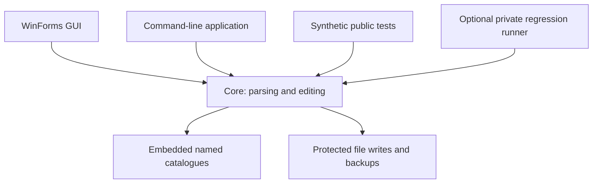

# Architecture

The repository separates the save format and mutation rules from Windows presentation. Both applications call the same Core API.

| Directory | Responsibility |
|---|---|
| `src/CtrNfSave.Core/Serialization` | Binary object graph, decoding, serialization and semantic diffs |
| `src/CtrNfSave.Core/Adventure` | Track definitions, progression rules, validation and cascades |
| `src/CtrNfSave.Core/Profiles` | Global inventory, skins, time trials, rewards and previewable bulk edits |
| `src/CtrNfSave.Core/Data` | Embedded JSON catalogues; names and recognized conditions |
| `src/CtrNfSave.Core/IO` | Fresh output, backups, external-change checks and fixture protection |
| `src/CtrNfSave.Gui` | Bootstrap, editor form, views, styling and EN/FR strings |
| `src/CtrNfSave.Cli` | Argument parsing, terminal output and CLI exit codes |
| `tests/CtrNfSave.Tests` | Package-free synthetic fixtures and executable assertions |
| `tests/CtrNfSave.Regression` | Optional legacy capture comparisons; no fixtures distributed |
| `scripts` | Repeatable build, test, audit and release packaging |
| `docs/format` | Evidence and limitations for supported fields |

## Save lifecycle

`Save.Parse` owns its input bytes and decodes the supported graph. Recognized changes operate on in-memory fields or narrowly scoped buffers. `Serialize` produces the edited representation while preserving uninterpreted data. Bulk plans are previewed before application; applying a plan does not itself write a file.

The `0xB400000C` envelope has a name-hash table before the pool sections; `0xB000000C` omits that table. A version-only global header is accepted only when the graph fully decodes without warnings, has exactly one `COctaneGlobalSaveData` root, has no Adventure slot root and occupies the global file size. Edits preserve the envelope and do not invent a slot-summary header or unresolved Garage handles. Both variants have synthetic regression coverage; recognizing the structure does not establish in-game compatibility for every edit.

A named local marketplace list with zero size/capacity and a `0xFFFFFFFF` memory reference is empty, rather than unsupported. Its first purchase appends a memory directory entry, an allocation ID and a data block. Existing IDs and payloads stay intact. Allocation reuses the file's verified primitive-memory descriptor shape (28 or 32 bytes), preserves its flags/pool, and requires verified zero padding. Unknown descriptor layouts are refused. Removing all purchases keeps the allocated empty block; it does not promise byte-identical restoration of the original unallocated representation.

FileWriter owns disk replacement. It refuses existing new-output files, checks the expected original bytes before in-place replacement, preserves a backup and uses a temporary output. The game must be closed before installing edited files. Backups are useful recovery copies, not a transaction across game/server state.

## Dependency direction

Core targets `net10.0`, without Windows or presentation dependencies. CLI and tests also target `net10.0`. GUI targets `net10.0-windows` with WinForms. Shared build settings enable nullable analysis, deterministic compilation and warnings as errors. No external application NuGet packages are required.

The form is intentionally kept as one coordinator while individual global/time-attack/navigation views live separately. Further extraction should follow behavior boundaries and tests, rather than moving code merely to make files smaller.
